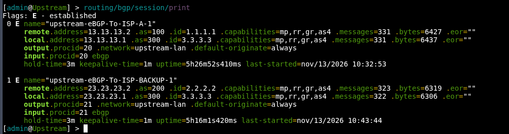

# Upstream Router Configuration (`AS 300`)

## 1. IP Addressing
Konfigurasi alamat IP *point-to-point* pada interface yang terhubung menuju masing-masing ISP:
* `ether1` (ke ISP-Primary): `13.13.13.1/30`
* `ether2` (ke ISP-Backup): `23.23.23.1/30`

*(Catatan: Sesuaikan nama interface dengan topologi fisik Anda jika menggunakan `ether2` dan `ether3`).*

```routeros
/ip address
add address=13.13.13.1/30 interface=ether1
add address=23.23.23.1/30 interface=ether2
```

---

## 2. Firewall Address-List (Network Advertisement)
Di MikroTik RouterOS v7, *prefix* yang akan di-*advertise* ke BGP dikelompokkan terlebih dahulu menggunakan `address-list` pada menu firewall:

```routeros
/ip firewall address-list
add list=lan-upstream address=13.13.13.0/30
add list=lan-upstream address=23.23.23.0/30
```

---

## 3. BGP Configuration

### A. Membuat BGP Template
Membuat *template* identitas dasar BGP lokal untuk menentukan **AS Number (`300`)** dan **Router ID (`3.3.3.3`)**:

```routeros
/routing bgp template
add name=upstream as=300 router-id=3.3.3.3
```

### B. Membuat BGP Connection (eBGP Peering)
Membangun sesi **eBGP** menuju kedua ISP menggunakan *template* yang sudah dibuat, sekaligus menyebarkan rute default (`0.0.0.0/0`) ke jaringan di bawahnya melalui parameter `output.default-originate=always`:

```routeros
# eBGP Peering menuju ISP-Primary (AS 100) via ether1
/routing bgp connection
add name=upstream-eBGP-To-ISP-Primary template=upstream \
    remote.as=100 remote.address=13.13.13.2 local.role=ebgp \
    output.network=lan-upstream connect=yes output.default-originate=always

# eBGP Peering menuju ISP-Backup (AS 200) via ether2
add name=upstream-eBGP-To-ISP-Backup template=upstream \
    remote.as=200 remote.address=23.23.23.2 local.role=ebgp \
    output.network=lan-upstream connect=yes output.default-originate=always
```

> **Catatan:** Pembentukan sesi *peering* eBGP bersifat dua arah (*bilateral*). Konfigurasi serupa juga harus diterapkan pada sisi **ISP-Primary** dan **ISP-Backup** agar sesi BGP dapat terbentuk.

---

## 4. Verifikasi Peering
Untuk memastikan sesi eBGP dari `Upstream` menuju kedua ISP sudah aktif, jalankan perintah berikut:

```routeros
/routing/bgp/session/print
```

**Indikator Berhasil:** Status sesi untuk `upstream-eBGP-To-ISP-Primary` dan `upstream-eBGP-To-ISP-Backup` muncul dengan tanda **`E` (*Established*)** beserta tabel informasi *peer* lawan.

