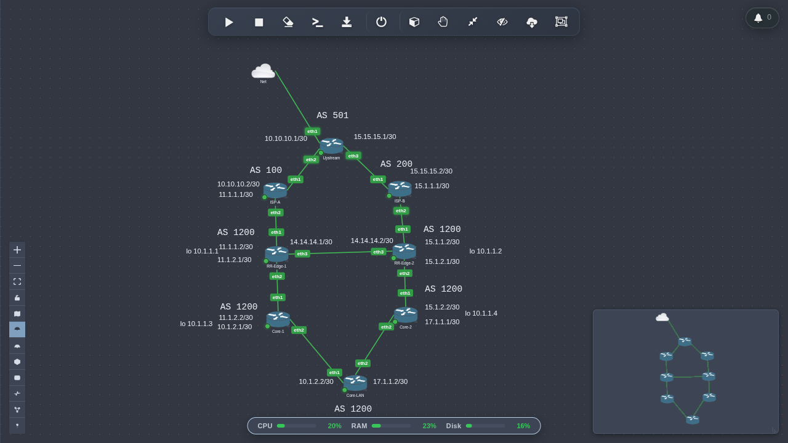

# Multi-Homed BGP Architecture with OSPF Underlay, Route Reflector & Prefix Filtering (AS 1200)

## 1. Overview
Lab ini mengimplementasikan arsitektur **Multi-Homed BGP pada AS 1200** menggunakan **OSPF sebagai IGP Underlay** dan **iBGP (Route Reflector) sebagai Overlay**. Desain ini dilengkapi dengan kebijakan *routing* (*BGP Prefix Filtering*) pada sisi *edge* untuk mencegah masuknya *Bogon/Private IP* dari ISP, mencegah *AS-Path loop*, serta menerapkan kebijakan *Anti-Transit* dengan hanya mengiklankan blok IP publik milik internal (`103.10.10.0/24`) ke internet.

---

## 2. Topology & Addressing Plan



| Device | Role / ASN | Interface | IP Address | Description |
| :--- | :--- | :--- | :--- | :--- |
| **UPSTREAM** | Upstream Provider | `eth1` | `10.10.10.1/30` | Link ke ISP-A |
| | | `eth2` | `15.15.15.1/30` | Link ke ISP-B |
| **ISP-A** | Transit ISP 1 | `eth1` | `10.10.10.2/30` | Link ke UPSTREAM |
| | | `eth2` | `11.1.1.1/30` | Link eBGP ke RR-Edge-1 |
| **ISP-B** | Transit ISP 2 | `eth1` | `15.15.15.2/30` | Link ke UPSTREAM |
| | | `eth2` | `15.1.1.1/30` | Link eBGP ke RR-Edge-2 |
| **RR-Edge-1** | Edge & RR Server 1 (`AS 1200`) | `eth1` | `11.1.1.2/30` | Link eBGP ke ISP-A |
| | | `eth2` | `11.1.2.1/30` | Link OSPF PtP ke Core-1 |
| | | `eth3` | `14.14.14.1/30` | Link OSPF PtP ke RR-Edge-2 |
| | | `lo` | `10.1.1.1/32` | Router-ID & iBGP Loopback |
| **RR-Edge-2** | Edge & RR Server 2 (`AS 1200`) | `eth1` | `15.1.1.2/30` | Link eBGP ke ISP-B |
| | | `eth2` | `15.1.2.1/30` | Link OSPF PtP ke Core-2 |
| | | `eth3` | `14.14.14.2/30` | Link OSPF PtP ke RR-Edge-1 |
| | | `lo` | `10.1.1.2/32` | Router-ID & iBGP Loopback |
| **Core-1** | Core / RR Client (`AS 1200`) | `eth1` | `11.1.2.2/30` | Link OSPF PtP ke RR-Edge-1 |
| | | `eth2` | `10.1.2.1/30` | Link OSPF PtP ke Core-LAN |
| | | `lo` | `10.1.1.3/32` | Router-ID & iBGP Loopback |
| **Core-2** | Core / RR Client (`AS 1200`) | `eth1` | `15.1.2.2/30` | Link OSPF PtP ke RR-Edge-2 |
| | | `eth2` | `17.1.1.1/30` | Link OSPF PtP ke Core-LAN |
| | | `lo` | `10.1.1.4/32` | Router-ID & iBGP Loopback |
| **Core-LAN** | Distribution / RR Client (`AS 1200`) | `eth1` | `10.1.2.2/30` | Link OSPF PtP ke Core-1 |
| | | `eth2` | `17.1.1.2/30` | Link OSPF PtP ke Core-2 |
| | | `eth3-publik` | `103.10.10.1/24` | Blok IP Publik Internal AS 1200 |
| | | `lo` | `10.1.1.5/32` | Router-ID & iBGP Loopback |

---

## 3. Architecture & Design Logic

* **Underlay Network (OSPF):** Seluruh subnet *Point-to-Point* (`/30`) dan antarmuka *Loopback* (`/32`) di dalam `AS 1200` dijalankan di atas protokol OSPF (`Area 0`). Hal ini menjamin konektivitas internal tetap stabil dan memiliki jalur cadangan otomatis apabila salah satu link fisik terputus.
* **Overlay Network (iBGP & Route Reflector):** Sesi iBGP dibangun antar-IP *Loopback* agar sesi BGP tidak bergantung pada satu antarmuka fisik. Untuk menghindari kompleksitas *full-mesh* iBGP, **`RR-Edge-1`** dikonfigurasi sebagai **Route Reflector Server 1** dan **`RR-Edge-2`** sebagai **Route Reflector Server 2**, sehingga router di bawahnya (`Core-1`, `Core-2`, `Core-LAN`) cukup melakukan *peering* ke kedua IP *Loopback* RR tersebut sebagai *RR Client*.
* **Next-Hop Self (`nexthop-choice=force-self`):** Diaktifkan pada kedua router *edge* (`RR-Edge-1` dan `RR-Edge-2`) ke arah sesi iBGP agar router internal dapat menjangkau rute eksternal melalui IP *Loopback* masing-masing *edge router* tanpa perlu menyebarkan subnet eBGP eksternal ke dalam tabel OSPF.
* **BGP Routing Policy (Prefix Filtering):**
  * **BGP-IN (`input.filter`):** Menolak rute yang mengandung `AS 1200` pada atribut `AS-Path` (mencegah *routing loop*) serta memblokir *Bogon/Private IP* agar tidak mengotori tabel *routing* internal.
  * **BGP-OUT (`output.filter-chain`):** Menerapkan prinsip *Anti-Transit* dengan hanya mengizinkan prefix publik milik internal (`103.10.10.0/24`) untuk diiklankan keluar ke `ISP-A` dan `ISP-B`, serta menolak seluruh prefix lainnya.

---

## 4. Core Configuration

File konfigurasi lengkap (`.rsc`) untuk masing-masing node tersedia pada direktori berikut:
* 📂 [`configs/`](https://github.com/saNE90x/portofolio-saa-NE) *(sesuaikan dengan path folder repo config lo)*

<details>
<summary><b>Klik untuk melihat cuplikan Routing Filter pada RR-Edge-1 & RR-Edge-2</b></summary>

```routeros
/ip/firewall/address-list
add list=BOGON-PREFIX address=10.0.0.0/8
add list=BOGON-PREFIX address=172.16.0.0/12
add list=BOGON-PREFIX address=192.168.0.0/16
add list=BOGON-PREFIX address=127.0.0.0/8
add list=BOGON-PREFIX address=169.254.0.0/16
add list=AS1200-PUBLIC address=103.10.10.0/24

/routing/filter/rule
add chain=BGP-IN-ISP rule="if (bgp-as-path 1200) { reject }"
add chain=BGP-IN-ISP rule="if (dst in BOGON-PREFIX) { reject }"
add chain=BGP-IN-ISP rule="accept"

add chain=BGP-OUT-ISP rule="if (dst in AS1200-PUBLIC) { accept }"
add chain=BGP-OUT-ISP rule="reject"
